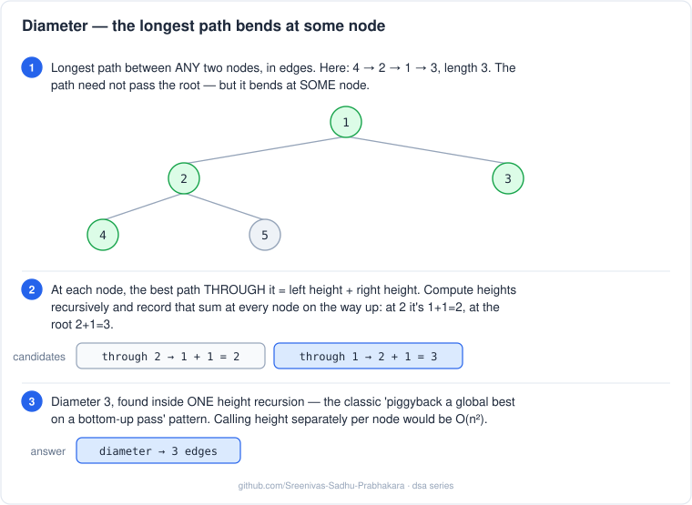

# Diameter of a Binary Tree

> Striver SDE Sheet 118 · Day 18 Binary Tree II — at every node the candidate diameter is left height + right height; collect the max inside one height pass. Go, stdlib only, tested.

## Problem

The longest path (in edges) between *any* two nodes in a binary tree — which need not pass through the root, the detail that invalidates the obvious `leftHeight + rightHeight` on the root alone.

## Approach

Every path has a unique topmost node where it "bends"; from that node it descends into the left and right subtrees, so its length is exactly leftHeight + rightHeight there. Checking that quantity at *every* node covers every possible path. The efficient trick is structural: the height recursion already visits every node bottom-up with both subtree heights in hand — so the diameter is a side effect collected in a closure variable, one pass, no second traversal. The naive version (call Height inside a Diameter recursion) is the O(n²) trap this problem exists to expose.

**Complexity:** O(n) time, O(h) recursion.

## Visual walkthrough

Read the picture top to bottom — each numbered frame is one moment of the algorithm
running on this repo's test example.

## Run

    go test ./...   # verify
    go run .        # demo

---

One of 191 repos solving Striver's SDE Sheet in Go — stdlib only, one problem per repo, every solution tested. Browse the set: [`dsa-*` repos](https://github.com/Sreenivas-Sadhu-Prabhakara?tab=repositories&q=dsa-&type=source).
